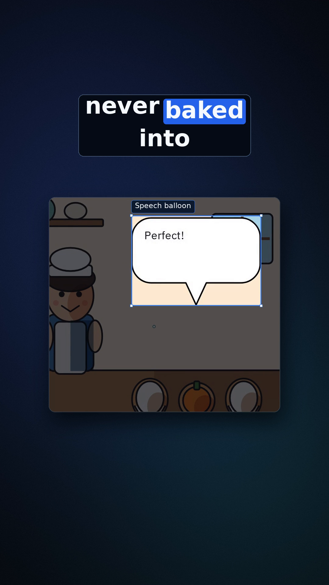
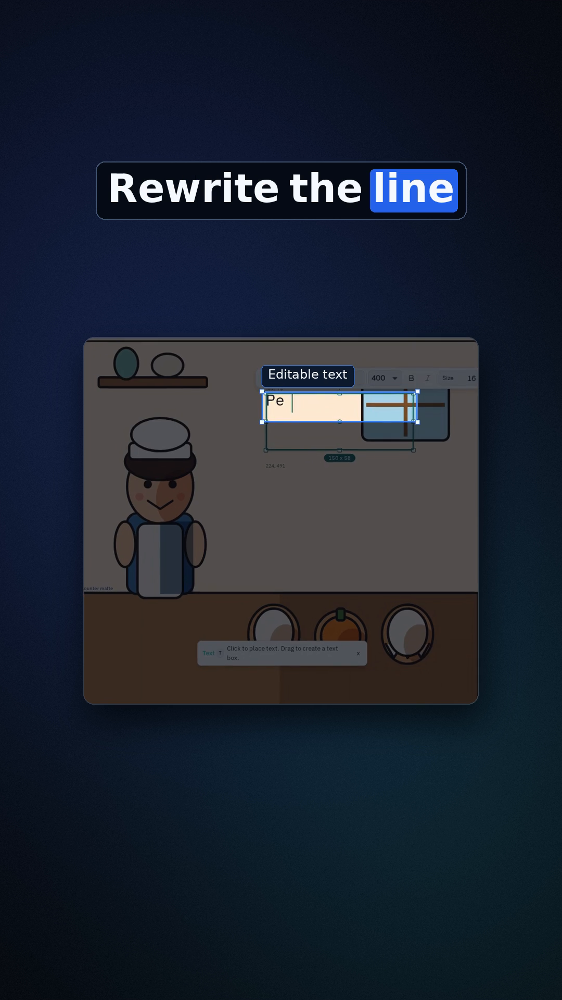
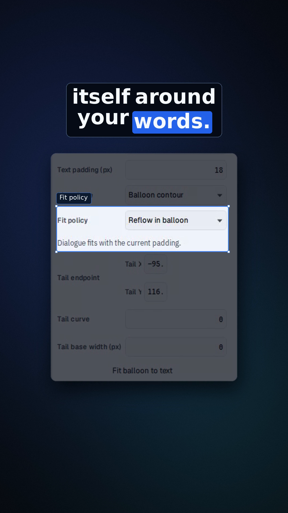
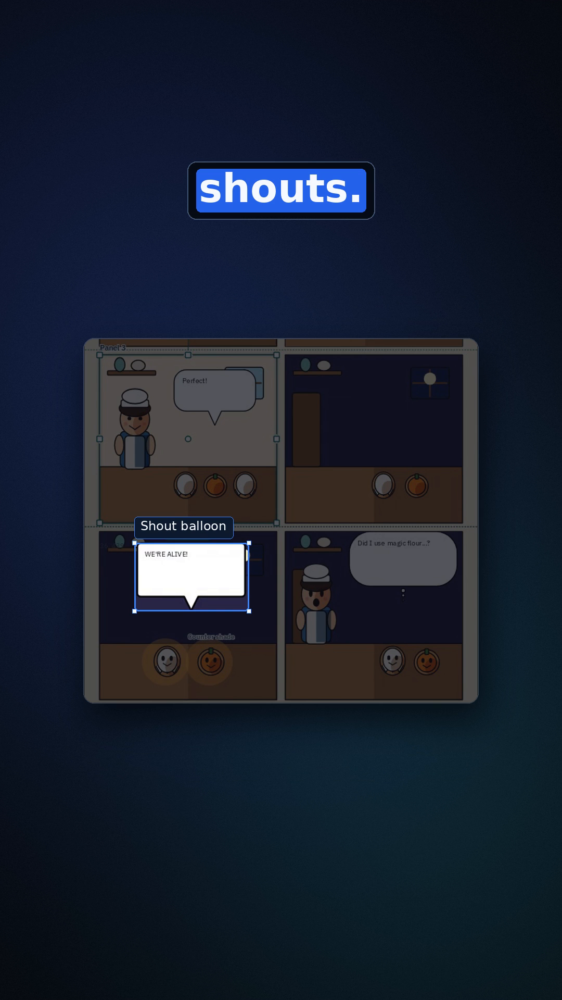
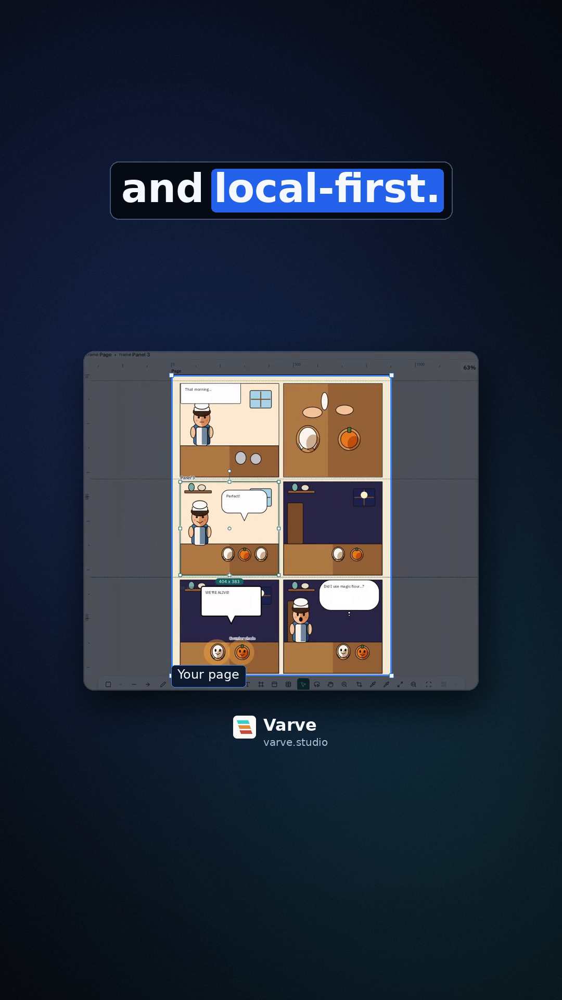
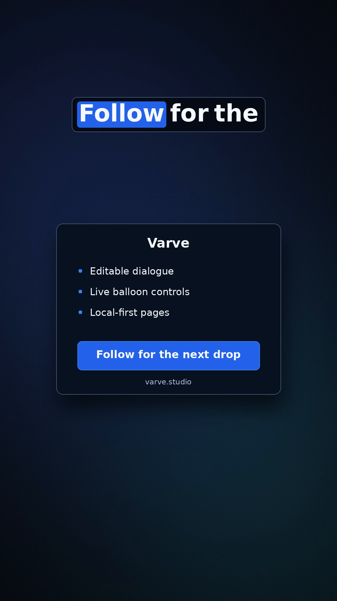

# Comic-lettering short V4

[Final MP4](out/comic-lettering-short-v4.mp4): **36 seconds, 1080 × 1920, 30 fps**, H.264 with Vanessa VO only. No music. The extra second preserves the complete supplied audio tails and the return to the opening page.

Branch `marketing/comic-lettering-short-v4` was created directly from `marketing/comic-lettering-short-v3` at `f87f5fcf6896a153a57f2e42028192af4be1b19d` ([V3 PR #114](https://github.com/K-Arthur/varve/pull/114)). Review target: `master`; do not merge before owner review.

## Visual direction

The reference studied was the 34.6-second email-v6 [final video](https://github.com/K-Arthur/varve/blob/marketing/email-short-v6/marketing/email-short-v6/out/v7.mp4), [render7.py](https://github.com/K-Arthur/varve/blob/marketing/email-short-v6/marketing/email-short-v6/render7.py), and [helpers6.py](https://github.com/K-Arthur/varve/blob/marketing/email-short-v6/marketing/email-short-v6/helpers6.py). V4 uses its navy/teal gradient, floating centered UI, restrained border/shadow, dark caption boxes, blue active-word treatment, dimmed spotlights, blue rounded outlines, and small dark labels. Camera moves use cubic ease-in-out over 0.5 seconds, then hold. The end card recaps the product and asks viewers to follow before returning to the opening page.

Captions use short phrases in the top-center safe area. The render and validator enforce text/background bounds within x 150–930 and y 290–1440, preserving the rightmost 150 pixels.

## Voice and timing decision

The six `vo3-*.mp3` files and [vo3-timings.json](vo3-timings.json) are the **unchanged original uploads**, with SHA-256 provenance recorded in [timing-audit.json](timing-audit.json). Their original beat offsets are retained.

The nested [biome.json](biome.json) inherits the repository configuration and disables formatting only for `vo3-timings.json`, preserving that required upload byte-for-byte. Other files retain the normal formatting/lint rules.

The supplied word labels conflict with the actual speech: the two-model audit found **53 of 72 word onsets differed by more than 250 ms**, with discrepancies up to 2.244 seconds. The owner explicitly selected corrected timings aligned to the audio. The renderer therefore uses the separate [caption-timings.json](caption-timings.json), derived from PocketSphinx word alignment and checked against independent Wav2Vec2 ASR/CTC alignment on every beat. See [timing evidence](timing-evidence.md), the [playable waveform review](out/timing-review.html), and the [72-word comparison](word-timing-comparison.csv) for methods, original audio, and word-span comparisons.

These acoustic boundaries have approximate ±50–150 ms uncertainty, not millisecond ground-truth precision. Blue highlighting evaluates each corrected absolute interval as `word.start <= frame / 30 < word.end`, without added anticipation, delay, or filling silent gaps. At 30 fps, visible transitions are quantized to 33.33 ms frames. Every complete original MP3 is mixed at its uploaded beat start; the uploaded `duration` is not used to trim audible final consonants.

All values below are seconds. “Uploaded duration” describes the supplied label, not the complete MP3 length. “Corrected voice end” is the final aligned word boundary in the finished timeline.

| Beat | Script / visual focus | Uploaded start | Uploaded duration | Corrected voice end |
|---|---|---:|---:|---:|
| 1 | “What if your comic dialogue was never baked into pixels?” — page, then speech balloon | 0.000 | 3.985 | 4.110 |
| 2 | “In Varve, dialogue lives inside the balloon. Rewrite the line as your scene develops.” — text entry, Editable text spotlight | 4.390 | 6.303 | 10.830 |
| 3 | “When a line gets longer, the balloon fits itself around your words. Tails, padding, style, all live.” — Comic balloon inspector, fit policy, live tail | 11.103 | 7.850 | 19.123 |
| 4 | “Speech, thoughts, shouts. Every balloon stays part of the design.” — three balloon types, page | 19.358 | 5.458 | 24.868 |
| 5 | “Varve is free and local-first. Your pages never leave your machine.” — complete page and Varve mark, then page spotlight within the editor | 25.221 | 5.181 | 30.441 |
| 6 | “What would your comic say? Follow for the next drop.” — dialogue detail, recap/follow card, loop return | 30.807 | 3.876 | 34.887 |

## Recorded source and edit

The required [lettering-vertical.mp4](../sample-comic/video/lettering-vertical.mp4) comes from `cursor/comic-lettering-videos-04c3`. The inherited [lettering-timelapse.mp4](../sample-comic/video/lettering-timelapse.mp4) supplies the legible page/text footage; [balloon-tail-loop.mp4](../sample-comic/video/balloon-tail-loop.mp4) supplies the tail interaction. All are recorded application footage. Source audio is discarded.

**Evidence limit:** the available text interaction shows text entry before balloon creation. It does not directly demonstrate rewriting existing dialogue or a balloon automatically growing around newly added words. The inspector shows the relevant fit/padding/style controls. V4 retains the requested VO but does not manufacture an editing or automatic-growth interaction to match it.

[edit-plan.json](edit-plan.json) is the complete frame-based EDL: every source path, source start, playback rate, starting/ending crop, card size, focus box, and label is explicit. Crop/focus rectangles are `[left, top, right, bottom]` in source pixels. `speed: 0` holds one genuine source frame. Timeline frame ranges are start-inclusive/end-exclusive.

| Timeline | Shot | Source start / playback |
|---|---|---|
| 0.000–2.200 | Opening page | timelapse 43.000 / still |
| 2.200–4.400 | Speech balloon | timelapse 41.050 / 0.60× |
| 4.400–6.700 | Editable text | vertical 18.000 / still |
| 6.700–8.900 | Text entry | timelapse 17.200 / 0.75× |
| 8.900–11.100 | Text detail | timelapse 15.850 / 0.30× |
| 11.100–13.500 | Balloon controls | vertical 44.000 / still |
| 13.500–15.500 | Fit policy | vertical 44.000 / still |
| 15.500–17.600 | Padding/style controls | vertical 44.000 / still |
| 17.600–19.367 | Live tail | tail loop 2.000 / 0.80× |
| 19.367–22.900 | Speech → thought → shout spotlights | timelapse 43.500 / still; focus changes at 20.433 and 21.433 |
| 22.900–25.233 | Complete page | timelapse 43.500 / still |
| 25.233–27.800 | Local-first page/mark | timelapse 43.000 / still |
| 27.800–30.800 | Editor context with “Your page” spotlight/mark | timelapse 43.000 / still |
| 30.800–33.100 | Speech detail with “Your dialogue” spotlight | timelapse 41.050 / still |
| 33.100–35.500 | Recap/follow card | Rendered end card |
| 35.500–36.000 | Return to opening | timelapse 43.000 / still |

## Six frame grabs

These PNGs are extracted from the encoded MP4, not generated preview frames.

| 3.000 s · frame 90 | 9.000 s · frame 270 | 15.000 s · frame 450 |
|---|---|---|
| [](out/frame-01.png) | [](out/frame-02.png) | [](out/frame-03.png) |

| 22.000 s · frame 660 | 28.000 s · frame 840 | 33.667 s · frame 1010 |
|---|---|---|
| [](out/frame-04.png) | [](out/frame-05.png) | [](out/frame-06.png) |

## Reproduce and validate

Run from the repository root with Python 3, Pillow, NumPy, FFmpeg/FFprobe, and DejaVu Sans installed. The media validator also uses SciPy. The optional speech-alignment audit has separate pinned dependencies and commands in [timing-evidence.md](timing-evidence.md).

```sh
python marketing/comic-lettering-short-v4/render.py --preview
python marketing/comic-lettering-short-v4/render.py --frame 270
python marketing/comic-lettering-short-v4/render.py
python marketing/comic-lettering-short-v4/validate.py
```

Previews and the intermediate silent video go to `work/comic-lettering-v4/` beside the worktree. The final MP4, six PNGs, normalized VO WAV, and validation evidence go to this directory's `out/`.

The validator checks the delivered encoded media: format/frame count; seven original-upload hashes and branch ancestry; complete audio/video decode and black-frame detection; loudness/true peak; independent six-VO reconstruction, sample alignment and final consonants; all 1,080 caption frames against all 72 corrected word intervals; safe bounds; exact frame-grab provenance; and first/last-frame loop continuity. Matching the six-VO reconstruction also checks that no music was added. These checks establish implementation fidelity to the corrected intervals; acoustic-boundary uncertainty remains as stated above.

The full render and encoded-media validator **passed**. [validation.json](out/validation.json) records the delivered MP4's hash and these measured results:

| Check | Result |
|---|---|
| Encoded media | 36.000 seconds; 1,080 frames; 1080 × 1920; exact 30 fps; H.264/AAC; full decode passed; no detected black interval |
| Captions | All 1,080 encoded frames and 72 corrected words checked; zero highlight mismatches or unexpected blue pixels; all caption bounds safe |
| Original VO placement | All six clips retained complete; strongest correlation lag is 0 samples for every beat; final 250 ms speech-window correlations exceed 0.99985 |
| VO-only mix | Independent six-VO reconstruction correlation 0.999994; residual −49.00 dB, consistent with AAC coding; no added music |
| AAC terminal duration | 512 samples / 10.667 ms shorter after decoding; difference contains only silence after all complete clips |
| Loudness | −15.98 LUFS integrated; −1.42 dBTP true peak |
| Grabs and loop | All six PNGs exactly match their encoded frames; first/last-frame loop check passed |
| Provenance | All seven original-upload hashes unchanged; required branch and V3 base ancestry passed |

Repository validation also passed. The planner selected Tier 0 formatting/lint/emoji checks only, with no affected application packages and no escalation. The affected checks passed in 1.5 seconds. No application code changed; broad application tests were not selected.

```text
Changed scope: marketing/comic-lettering-short-v4/ media, render/audit scripts, evidence, README, scoped formatter configuration
Validation plan: Tier 0 only; formatting, lint, emoji; no affected application packages
Commands actually run:
  python3 marketing/comic-lettering-short-v4/render.py
  python marketing/comic-lettering-short-v4/validate.py
  pnpm_config_verify_deps_before_run=false pnpm verify:plan
  pnpm_config_verify_deps_before_run=false pnpm verify:affected
Passed: full render; all six encoded-media validation stages; repository formatting, lint, emoji
Skipped as unrelated: application unit/E2E/Rust suites; planner selected no application packages
Escalations: none
Full suite run: no
```
